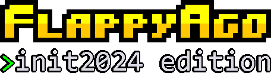

# INIT - mängu töötuba

- [Abivahendid](#abivahendid)
- [Sissejuhatus](#sissejuhatus)
- [Ülesanded](#%C3%BClesanded)
  - [🐍 PyGame paigaldamine](#-pygame-paigaldamine)
  - [🐦 Linnu loomine](#-linnu-loomine)
  - [🦅 Linnulennu loomine](#-linnulennu-loomine)
  - [🏃‍♂️💨 Torud liikuma](#%EF%B8%8F-torud-liikuma)
  - [👹 Uute torude loomine](#-uute-torude-loomine)
  - [🔢 Skoori arvutamine](#-skoori-arvutamine)
  - [🔊 Heliefektide lisamine](#-heliefektide-lisamine)
  - [⭐ Boonusülesanded](#-boonus%C3%BClesanded)

## Abivahendid
Kõige olulisem abivahend selles töötoas on **oskus küsida küsimusi**. Küsimusi soovitame julgelt küsida klassis ringi
liikuvate **abiõppejõudude käest**, kes on meeleldi valmis vastama kõigile küsimustele, mis tekkida võivad. Ära tunned
abiõppejõu musta TalTechi pusa või t-särgi järgi. Kui abiõppejõud Sinu küsimusele vastata ei oska, siis tasub appi võtta
[**Dr. Google**](https://google.ee). Väga suure tõenäosusega on keegi sama probleemiga juba maadelnud, ning sellele ka lahenduse
leidnud. Veel võid abi leida [PyGame ametlikust dokumentatsioonist](https://www.pygame.org/docs/). Ning kui kõigile abivahenditele vaatamata
siiski mingi asjaga hätta jääd, siis meie projekti kaustast [`solutions`](https://github.com/taltech-coding/init-pygame-2024/tree/main/solutions) võid leida ka ülesannete koostajate
lahendused. Tunnis kasutatud slaidiesitlust on võimalik järele vaadata
[siit](https://docs.google.com/presentation/d/17bwAzKgsy6hG3zJu4hbubYgroGwYZy9pT4Idesi9Hmo/edit)!

## Sissejuhatus
Oled praktikant ja sinu ülesandeks on anda viimane lihv tulevasele AAAA mängule "Flappy Ago: INIT2025 edition"!

Aga oh aeg - pool koodi on kogemata ära kustunud, sest üks töötajatest unustas oma muudatused salvestada!

Õnneks on jäänud alles varasemad arendaja juhised koodi dokumentatsioonis, seega saad selle abil koodi uuesti valmis
kirjutada ja mängu jõuab veel õigel ajal Steami üles panna!

Mäng on loodud mängumootor [PyGame](https://www.pygame.org/docs/) abil.

Kui sul läheb jooksvalt lahendamisega abi vaja siis oleme antud töötoast teinud ka video: [Video Flappy Bird lahendusest](https://www.youtube.com/watch?v=jMSewTuECrQ)

## Ülesanded

Oleme sulle ette valmistanud ülesanded ning ka lahendamiseks vajalikud juhtnöörid. Kui vajad abi, tõsta julgelt käsi 🙋‍♀️
või küsi Dr. Google-ilt. Peaasi on see, et täna siit midagi õpiksid!

### 🐍 PyGame paigaldamine

Enne programmeerima hakkamist tuleb meil avada kooditöötlusprogramm PyCharm, laadida alla meie kood, ning paigaldada
PyGame. Kõik kolm sammu teeme koos tunnis läbi. PyGame paigaldamiseks on vajalik avada PyCharmis Terminal (all vasakul,
näeb välja nagu `>_`. Sinna tuleb sisestada käsklus `pip install pygame` ning vajutada ENTER. Kui tekib mingi probleem,
siis tõsta julgelt käsi, kõik abiõppejõud ongi siin selleks, et teid aidata! Pärast seda saame hakata mängu koodi kallal
tööd tegema.

[Siit](https://youtu.be/jMSewTuECrQ?t=40) saad vaadata vajadusel ka videot antud sammu kohta.

### 🐦 Linnu loomine

Esiteks on meil vaja sisse laadida pilt linnukesest. Meil on sulle juba `images` kaustas ette antud pilt Agost, keda
võid "linnukesena" kasutada: `images/bird.png`.

Et pilt sisse laadida, muudame `resources.py` faili. Näidisena on meil juba eelnevalt muutujasse `background_img` laetud
taustapilt. Nüüd lae ise `images/bird.png` või mõni muu meeldiv pilt linnupildiks sisse. Muutuja nimeks peab olema
`bird_img`.

> `bird_img = ???`

Peale pildi sisselaadimist on teda vaja ekraanile ilmutada.

Et lindu ekraanile ilmutada, muudame `bird.py` faili.

Sealt otsi üles funktsioon `def draw():`. Kutsume selle all välja meetodi `screen.blit`.

```py
screen.blit(bird_img, (self.x, self.y))
# Ilmutame ekraanile linnu x ja y koordinaatidele linnu pildi.
```

Ava PyCharmis fail `flappy_bird.py`, vajuta ▶️ play nupule, ning näed, et sul ongi ekraanil linnuke!

[Siit](https://youtu.be/jMSewTuECrQ?t=114) saad vaadata vajadusel ka videot antud sammu kohta.

### 🦅 Linnulennu loomine

1. **Linnuke peaks gravitatsiooni tagajärjel pidevalt kukkuma.**

    Linnukesel on muutuja `self.velocity`, mis näitab linnu kiirust y-koordinaadi suhtes. Peaksime igal kaadril e.
    frame'il liitma sellele kiirusele gravitatsiooni kiirenduse.

    Loo faili `constants.py` muutuja `GRAVITY` - selle väärtuseks sea `1.2`. Võid muidugi seda väärtust timmida, et
    mängu huvitavamaks muuta. 😉

    Seejärel otsi failist `bird.py` üles `class Bird`. Selle all on funktsioonid, mis seonduvad linnuga. Iga kaader
    kutsutakse välja `def update()` funktsiooni. Sinna alla pead kirjutama kiirenduse koodi!

    Lisaks `self.velocity`-le `GRAVITY` liitmise tuleb igal kaadril `self.y`-ile, ehk linnu y-koordinaadile, liita tema
    kiirus y-koordinaadi suhtes, ehk `self.velocity`.

    [Siit](https://youtu.be/jMSewTuECrQ?t=229) saad vaadata vajadusel ka videot antud sammu kohta.

    <details>
    <summary>💡 Kuidas luua, liita ja lahutada muutujaid Python-is?</summary>

    ```py
    # Loome muutuja 'x', ning seame selle väärtuseks 0.
    x = 0
    x += 5  # muutujale viie liitmine
            # x on nüüd 0 + 5 = 5
    x -= 2  # muutujast kahe lahutamine
            # x on nüüd 5 - 2 = 3
    # saad ka liita mõne muu muutuja võrra
    teine_muutuja = 5
    x += teine_muutuja
    # x on nüüd 3 + teine_muutuja = 3 + 5 = 8
    ```
    </details>

&nbsp;


2. **Kui mängija vajutab tühikule, peaks linnuke ülespoole hüppama.**

    Siin uuendame linnukese kiirust, kuid seekord sätime linnu kiiruse hüppamise kiiruseks.

    Et PyGame arvutab koordinaate "tagurpidi" (numbrid suurenevad ülevalt alla liikudes), peaks üles liikumiseks kiirus
    olema negatiivne.

    Arvesta, et ekraani miinimumpunkt (0,0) asub ekraani vasakul üleval nurgas ja maksimumpunkt all paremal nurgas!

     ```
    # Näidis ekraani koordinaatidest

    MIN----->600 (x)
    |   E   |
    |   K   |
    |   R   |
    |   A   |
    |   A   |
    |   N   |
    v------MAX
    900

    (y)
    ```

    Loo faili `constants.py` muutuja `BIRD_JUMP`, ning sea selle väärtuseks `15`.

    Sulle on faili `bird.py` valmis tehtud `def flap()` funktsioon, mida kutsutakse välja siis, kui vajutatakse
    tühikule.

    Selle funktsiooni all peaksid `self.velocity` muutujaks seadma NEGATIIVSE `BIRD_JUMP`-i väärtuse.

    [Siit](https://youtu.be/jMSewTuECrQ?t=330) saad vaadata vajadusel ka videot antud sammu kohta.


3. **Kui linnuke puudutab maad, peaks mäng lõppema.**

    Selle jaoks tuleb realiseerida failis `bird.py` funktsioon `check_collision_with_floor()`.

    Ülevalt alla liikudes y-koordinaat suureneb. Seega, juhul kui linnu y-koordinaat on suurem kui ekraani kõrgus,
    millest on lahutatud linnupildi enda kõrgus, siis tuleks tagastada `True`. Igal muul juhul tuleks tagastada `False`.

    Vastavalt eelnevatele lausetele saame sellesse funktsiooni kirjutada järgneva `if` kontroll-lause:

    Juhul kui `self.y` on suurem kui `SCREEN_HEIGHT - 50`, siis tagasta (ehk `return`) `True`, muul juhul (`else`)
    tagasta `False`.

    [Siit](https://youtu.be/jMSewTuECrQ?t=409) saad vaadata vajadusel ka videot antud sammu kohta.

### 🏃‍♂️💨 Torud liikuma

Lisa `pipe.py` failis `def update():` meetodi alla koodijupp, mis iga kaader lahutab `self.x`-ist konstandi
`PIPE_VELOCITY`.

Toru liikumise kiirust (`PIPE_VELOCITY`) võid soovi korral timmida failis `constants.py`.

[Siit](https://youtu.be/jMSewTuECrQ?t=472) saad vaadata vajadusel ka videot antud sammu kohta.


### 👹 Uute torude loomine

Iga natukese aja tagant peaks tekkima ekraanile uus toru, mille vahelt peab linnuke läbi lendama.

Meil on järjend (justkui nimekiri) torudest, mida hoitakse muutujas `pipes`. See muutuja asub failis `flappy_bird.py`.
Kui soovime pääseda ligi mõnele kindlale elemendile selles järjendis, siis seda saame teha \[kantsulgude\] abil.

Kui soovime saada kätte järjendist elemendi (meil siis toru) indeksiga 0, siis peaksime kasutama viidet `pipes[0]`.
Tasub tähele panna, et miinusmärgiga indeksid võimaldavad järjendi elemente kätte saada "tagantpoolt". Seega viide
`pipes[-1]` annab meile selle järjendi viimase elemendi.

Uute torude tekitamiseks tuleb kirjutada paar rida koodi. Selleks sobiv koht on failis `flappy_bird.py`.

> Õiget kohta näitab kommentaar `# TODO: Generate new pipes`!

Mõistlik oleks näiteks kontrollida, kas järjendi viimane element (`pipes[-1]`) on jõudnud x-teljel koordinaadile, mis on
väiksem kui konstandis `DISTANCE_BETWEEN_PIPES` määratud kaugus. Viimase toru x-koordinaati saame küsida viitega
`pipes[-1].x`.

Meeldetuletuseks: liikudes paremalt vasakule koordinaatide numbriline suurus väheneb!

<details>
<summary>💡 Proovi ise mõelda välja, kuidas sellist kontrolli koodis vormistada! Kui oled oma lahenduse välja mõelnud,
siis kontrolli siit, kas Sinu lahendus oli õige.</summary>

```py
if pipes[-1].x < DISTANCE_BETWEEN_PIPES:
    # Nüüd on õige aeg lisada uus toru!
```
</details>

&nbsp;

Juhul kui eelnevalt kirjeldatud tingimus on tõene, siis järelikult on kätte jõudnud õige aeg tekitada uus toru! Selleks
kasutame järjendi meetodit `append`, et lisada järjendi lõppu uus toru. Sobiv koodijupp oleks näiteks
`pipes.append(Pipe())`. Meenutame veel, et kui mõni koodirida on meil lõppenud kooloniga `:`, siis järgnevat rida peame
koodivea vältimiseks alustama taandreaga (selleks saad kasutada klahvi Tab, mis asub klaviatuuri üleval vasakus nurgas).

[Siit](https://youtu.be/jMSewTuECrQ?t=518) saad vaadata vajadusel ka videot antud sammu kohta.

### 🔢 Skoori arvutamine

Torude vahelt läbimine peaks mängija skoorile andma plusspunkti.

Esiteks on meil vaja kirjutada kood, mis arvutab välja, kas mängija on torust läbi saanud.

Meil on teada, kus asuvad toru ja linnuke koordinaatteljestikul. Siis kui linnukese asukoht x-teljel on suurem kui toru
keskpunkt, lisame mängijale punkti.

Torul on `has_been_passed` muutuja, mis võib olla `True` või `False` ehk tõene või väär.

Esiteks otsi failist `flappy_bird.py` üles koodijupp, kus me uuendame iga toru asukohta, ning joonistame igat toru
ekraanile.

<details>
<summary>🧐 See peaks välja nägema umbes selline:</summary>

```py
for pipe in pipes.copy():
    pipe.update()
    pipe.draw()

    # TODO: Detect if bird is currently between pipes.
    # If yes, add +1 to the score.
    # Don't forget to update the pipe's has_been_passed value to True!
    # You can try to play a point sound here as well.
```

</details>

&nbsp;

Selle `for` loopi alla, kus me igast torust üle käime, peaksime lisama järgneva `if` kontrolli:

Kui `has_been_passed` on `False` ning `bird.x` on suurem kui `pipe.x + 25`, säti, et `has_been_passed` on tõene ehk
`True`. Seejärel peaksime ka `score` muutujale liitma ühe. Võiks ka mängida mingit heliefekti? 🤔

[Siit](https://youtu.be/jMSewTuECrQ?t=628) saad vaadata vajadusel ka videot antud sammu kohta.


### 🔊 Heliefektide lisamine

Esiteks peame sisse laadima helifailid, et saaksime neid mängu jooksul mängida.

Ava fail `resources.py`, ning lisa sinna `hurt_sound` ja `point_sound` muutujad. Abiks vaata, kuidas `flap_sound` on
loodud.

|**muutuja nimi**|**heliefekti asukoht**|
|-|-|
|`hurt_sound`|`sounds/hurt.wav`|
|`point_sound`|`sounds/point.wav`|

&nbsp;

Failis `flappy_bird.py` on sulle ette toodud kohad, kus võiks mõni heliefekt mängida!
Nendes kohtades on kirjas `# TODO: Play a sound!`

Et heliefekti mängida, pead kutsuma vastava heliefekti muutuja alt välja `.play()` meetodi.

Näiteks, et mängida `flap_sound`-i, kirjutasime me mängukoodi, et kui mängija vajutab tühikule, siis ...
```py
flap_sound.play()
```

[Siit](https://youtu.be/jMSewTuECrQ?t=744) saad vaadata vajadusel ka videot antud sammu kohta.

### ⭐ Boonusülesanded
- 👑 Tee nii, et skoori suurenedes läheks mäng kiiremaks või raskemaks.
- 👑 Tee nii, et liikumisel taust vaikselt kaasa liiguks. *(Parallax scrolling)*
- 👑 Lisa maapind.
- 👑 Tee nii, et lind vaatab liikumise suunas üles/alla.
- 👑 Lisa visuaalseid efekte? :)
